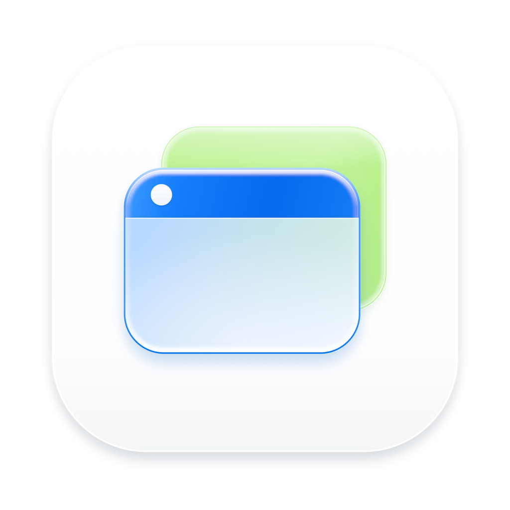

  

<h1 align="center">Quickie</h1>

A quick lookup. Then back to what you were doing.

Free for macOS · Apple Silicon · macOS 26+

Quickie opens Google in a temporary browser window with a keyboard shortcut. Search, browse a result, then dismiss the window when you're done—without adding another tab to your main browser.

## Download

**[Download Quickie for Mac](https://github.com/Devesh-Ahuja/Quickie/releases/latest/download/Quickie.dmg)**

Current release: **0.1.0 (build 2)**. **First time installing?** Read the [first-launch instructions](#first-launch-apple-could-not-verify-quickie) below if macOS blocks Quickie.

Find release notes and the SHA-256 checksum on the [Releases page](https://github.com/Devesh-Ahuja/Quickie/releases). The DMG is also available in each release's **Assets** section. The repository's **Code → Download ZIP** option is not the app installer.

**Requirements:** an Apple Silicon Mac (M-series), running macOS 26 or later. The current build does not support Intel Macs.

## What Quickie does

- Opens a Google lookup with your chosen keyboard shortcut.
- Dismisses with Escape, the close button, the same shortcut, or a click outside the window.
- Remembers your preferred window size and position.
- Supports back, forward, refresh, two-finger navigation swipes, and pinch zoom.
- Copies the current page's link or opens it in your default browser.
- Keeps website cookies and logins between lookups.
- Offers launch at login, an optional menu bar icon, and System, Light, or Dark window appearance.

## Install

1. Download **Quickie.dmg** from [Releases](https://github.com/Devesh-Ahuja/Quickie/releases).
2. Open the DMG and drag **Quickie** onto the **Applications** shortcut.
3. Eject the disk image, then open **Quickie** from Applications.
4. If macOS blocks the first launch, follow the steps below. Once Quickie opens, choose a keyboard shortcut in its setup/settings window.

### First launch: “Apple could not verify Quickie”

Quickie is currently distributed without Apple Developer ID signing or notarization. macOS may show **“Quickie” Not Opened** and say Apple could not verify it is free of malware. This message means Apple has not verified the app; it is not, by itself, a malware detection.

If you trust the copy downloaded from [Quickie's official GitHub release](https://github.com/Devesh-Ahuja/Quickie/releases), follow these steps:

1. Try opening **Quickie** from **Applications** once, so macOS displays the warning.
2. Click **Done** in that warning, rather than **Move to Trash**.
3. Open **Apple menu → System Settings → Privacy & Security**.
4. Scroll to the **Security** section. Find the message about Quickie being blocked and click **Open Anyway**.
5. Authenticate with Touch ID or your Mac's password if asked, then click **Open** in the confirmation.

After this approval, you can open that installed copy normally. A future download or update may require approval again.

**No Open Anyway button?** Try opening Quickie from Applications again, then return to Privacy & Security. Apple makes the button available for about an hour after a blocked attempt. On a work or school Mac, an administrator may restrict this option.

These steps apply to the unverified-developer warning above. If macOS reports malware or says the app is damaged, stop and [report the exact message](https://github.com/Devesh-Ahuja/Quickie/issues/new?template=bug_report.yml) instead.

No Terminal commands or system-wide security changes are needed. See [Apple's guide to opening an app by overriding security settings](https://support.apple.com/guide/mac-help/mh40617/mac).

## Use Quickie

Press your shortcut, type into Google's search field, and press Return. Browse inside the preview, or choose **Open in browser** to continue in your default browser. Closing the preview ends that lookup; the next opening starts at Google's homepage.

Open settings from the gear in the preview window or the menu bar menu. You can change your shortcut, reset window placement, or clear website data there. If you hide the menu bar icon, settings remain available through the preview's gear.

### Keyboard shortcuts

Use **Quick choices** for a preset, or **Record Shortcut** to choose your own. Modifier shortcuts such as Option + backtick are supported, as are pairs of typing keys: hold the first and press the second.

Two-typing-key shortcuts require macOS Accessibility permission. Quickie provides **Open Accessibility Settings** and **Retry Shortcut** when needed. A future app update may require you to grant this permission again.

## Website data

The window is temporary, but the browsing session is not automatically private or incognito. Quickie retains its own cookies and supported logins; it does not import your Safari or Chrome credentials. Google and websites you visit may retain activity according to their own settings and policies.

Use **Clear Website Data…** in settings to remove Quickie's stored website data. Some websites do not allow sign-in inside an embedded browser; **Open in browser** is available for continuing there.

## Feedback

Found a problem? [Report a bug](https://github.com/Devesh-Ahuja/Quickie/issues/new?template=bug_report.yml) or [suggest a feature](https://github.com/Devesh-Ahuja/Quickie/issues/new?template=feature_request.yml). Please remove personal information from screenshots before posting.

## About this repository

Quickie is free to download and use. This public repository contains app downloads, release notes, and support information. The application's source code is private and is not included here.
